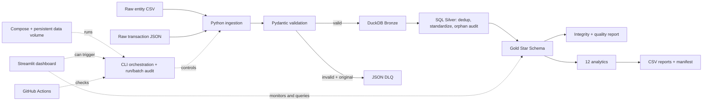

# goML Data Engineering Case Study

Local ELT pipeline for entity CSV and transaction JSON data. It validates each record before Bronze, appends invalid originals to a DLQ, transforms accepted data through DuckDB Bronze/Silver/Gold, builds a Star Schema, and exports quality and analytical reports. Python 3.10+, DuckDB, Pydantic v2, pytest, standard-library JSON logging; no cloud service required.

## Features

- Seeded mock data with deliberate defects and configurable paths/counts.
- Strict contracts, row-level rejection, append-only DLQ, and structured error detail.
- SQL transformations with `ROW_NUMBER()` entity deduplication and orphan audit.
- Batch hashes, incremental skip/idempotence, conflict detection, and persisted run audit.
- Gold integrity assertions, 12 analytics, machine-readable quality report, CSV export.
- Local Streamlit dashboard for pipeline health, data quality, warehouse layers, and interactive query results.
- Docker Compose with persistent volume and health check; GitHub Actions CI.

## Setup and commands

Python 3.10+ is supported. From repository root:

```powershell
python -m venv .venv
.\.venv\Scripts\Activate.ps1
python -m pip install -r requirements.txt
python -m pip install -e .
```

Default data paths are under `./data` relative to `--root` (defaults to current directory). Path overrides: `GOML_RAW_DIR`, `GOML_ENTITIES_PATH`, `GOML_TRANSACTIONS_PATH`, `GOML_DLQ_DIR`, `GOML_DATABASE_PATH`, `GOML_REPORTS_DIR`. Set logging with `--log-level` or `GOML_LOG_LEVEL`; `--run-id` can assign an explicit run identifier. No secrets or `.env` file are required.

```powershell
goml-pipeline generate --entities 200 --transactions 1000 --seed 42
goml-pipeline run
goml-pipeline run --incremental --no-generate
goml-pipeline analytics --as-of 2026-10-27
goml-pipeline latest-run
goml-pipeline health
pytest --cov=goml_pipeline
```

## Local dashboard

Launch the interactive dashboard from the repository root:

```powershell
streamlit run dashboard.py
```

Open `http://localhost:8501`. The Overview shows layer counts, data-flow stages, and transaction charts. Query Explorer runs any of the 12 analytics, shows its SQL, and downloads the selected result as CSV. Data Quality shows accepted/rejected counts and Gold integrity checks. Use **Run pipeline** in the sidebar to generate the sample inputs and refresh the warehouse and reports.

The interface uses a quiet teal, navy, and off-white palette. The dashboard reads the same local DuckDB file and reports as the CLI; no external services or credentials are needed. Currency charts keep currencies separate and do not apply FX conversion. To run it in Docker:

```powershell
docker compose up --build dashboard
```

Then open `http://localhost:8501`. Docker Compose maps host `./data` into the dashboard container so its state and outputs remain visible locally.

Alternatively run `python -m goml_pipeline.main run` after installing editable or setting `PYTHONPATH=src`. Generator entity count is clean base rows; each complete group of 100 adds at least five exact duplicate rows and five separate malformed-email rows. For smaller counts, one of each is injected. Requested transaction count is the final row count; deterministic defects are included (negative amount, null entity ID, unsupported currency). Transaction timestamps span several months around the current calendar period; same seed/counts within the same calendar month yield the same files.

## Source, layers, and modeling

Entity fields: `entity_id, first_name, last_name, contact_email, registration_date, region`; transaction fields: `transaction_id, entity_id, category, transaction_amount, currency, timestamp`. Dates are ISO dates; timestamps ISO 8601 UTC. Bronze keeps validated source fields plus load metadata. Silver trims/normalizes text and regions, deduplicates on entity UUID, and separately records valid-contract transactions whose entity reference is absent. For conflicting entity rows, the lexicographically smallest source-content hash wins; exact duplicates are equivalent.

Gold contains `dim_entity`, `dim_date`, and `fact_transactions`. Entity keys use deterministic row numbers over sorted UUIDs and are rebuilt on full runs; date key is `YYYYMMDD`. Fact grain is one row per transaction ID. Identical repeated IDs are skipped; changed content for an existing ID fails incremental processing. Amounts remain in source currencies, and monetary analytics group by currency. There is no FX conversion. The regional average query first averages transactions per entity, then equally averages entity means per region and currency. Top-five rankings are within currency so unlike amounts are never ranked against each other.

### Analytics catalog

All 12 queries run through `goml-pipeline analytics` and the pipeline run, and are exported as CSV. Both mandatory questions have known-answer fixture tests; the end-to-end test executes and parses all query outputs.

| Query | Business question and calculation | Output columns |
|---|---|---|
| `monthly_revenue_by_category` | Current UTC calendar month amount by category, excluding future months | `category, currency, total_transaction_amount` |
| `top_regions_average_per_entity` | Average transactions per entity, then equal-weight entity means by region; rank within currency | `region, currency, average_transaction_amount_per_entity` |
| `transaction_count_amount_by_region` | How many transactions and what amount per region | `region, currency, transaction_count, total_amount` |
| `monthly_transaction_volume` | How transaction counts change by month | `year, month, month_name, currency, transaction_count` |
| `top_entities_by_amount` | Top five entities by transaction amount within each currency | `entity_id, first_name, last_name, currency, total_amount` |
| `category_distribution` | Transaction counts and amounts by category | `category, currency, transaction_count, total_amount` |
| `daily_transaction_activity` | Daily count and amount of activity | `full_date, currency, transaction_count, total_amount` |
| `new_entity_registrations_by_month` | How many entities registered by month and region | `year, month, region, new_entities` |
| `transaction_amounts_by_currency` | Count, total, and average transaction amount by currency | `currency, transaction_count, total_amount, average_amount` |
| `average_amount_and_count_by_entity` | Average amount and transaction count for each entity | `entity_id, region, currency, average_transaction_amount, transaction_count` |
| `entity_activity_distribution` | Active and inactive entity counts and transaction volume by region | `region, entity_count, active_entities, transaction_count` |
| `data_quality_summary` | How many persisted pipeline runs succeeded or failed | `status, run_count` |

The top-five queries can return up to five rows per currency because USD, EUR, and GBP values are not comparable without conversion.

## Outputs and operating semantics

- `data/raw/entities.csv`, `data/raw/transactions.json`
- `data/dlq/invalid_entities.json`, `data/dlq/invalid_transactions.json`: append-only; original input, structured errors, stable fingerprint, run/batch IDs, timestamp.
- `data/warehouse.duckdb`: layer tables, `pipeline_runs`, and `processed_batches`.
- `data/reports/data_quality_report.json`, `latest_run.json`, `analytics_manifest.json`, and 12 query CSV files. Stable report names are replaced on later runs.

Inspect warehouse tables with `python -c "import duckdb; c=duckdb.connect('data/warehouse.duckdb',read_only=True); print(c.execute('SHOW TABLES').fetchall()); c.close()"`. Inspect rejected examples directly in the two DLQ JSON files.

Default `run` refreshes Bronze from the current valid inputs and rebuilds Silver/Gold. `--incremental` uses SHA-256 source-pair batch identity and skips completed batches; repeated business IDs are idempotent and conflicting changed content fails. A full refresh resets the active processed-batch set while retaining run history. Failed database writes roll back and are not marked as processed. Run audit captures status/details in DuckDB. Logs are JSON lines on stderr. Bad records are recoverable individually; malformed files, ID conflicts, database/Gold integrity errors, and report errors fail the command.

## Architecture



Details: [architecture](docs/architecture.md), [requirements traceability](docs/requirements_traceability.md).

## Docker and CI

```powershell
docker compose build
docker compose run --rm pipeline
docker compose run --rm pipeline pytest
docker compose run --rm pipeline goml-pipeline health
```

Compose mounts host `./data` at `/app/data` to retain files and the database. Health checks require a queryable Gold fact table. CI runs lint, tests/coverage, and image build on push/pull request. Local configuration does not establish remote GitHub run success.

## Design and scaling

Pydantic provides the validation boundary; DuckDB gives local analytical SQL without a server; Bronze/Silver/Gold separates source fidelity from conformed and business-ready data; the Star Schema supports reporting. At terabyte scale, retain immutable batches in partitioned object storage, validate evolving schemas at ingestion, process incrementally with distributed engines, publish lakehouse tables, and query using a scalable warehouse. Add managed orchestration, lineage, centralized quality/monitoring, retries, and cost controls. Partitioning and incremental writes lower scan costs; resilient redundant services raise cost. These are future concepts only; this repository has no cloud deployment.

## Limitations

Surrogate keys are deterministic per rebuilt dimension, but may shift if a newly added UUID sorts earlier. Do not use them as externally durable identifiers. No currency conversion is provided. DLQ history is append-only and needs an explicit retention policy for long-running use. Use `--root` for a specific project and ensure source files exist with `--no-generate`.
