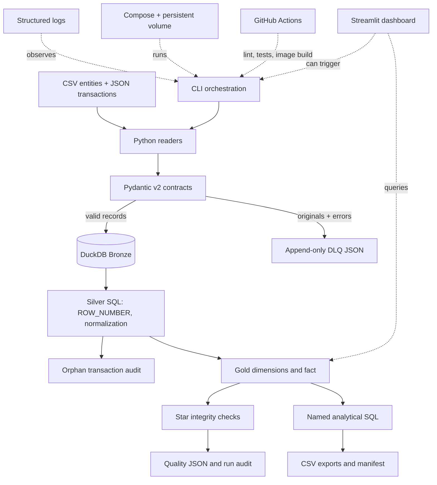

# Architecture and operational behavior

The Streamlit dashboard reads the same DuckDB warehouse and JSON reports, displays layer counts, quality metrics and charts, and provides a query explorer for all 12 analytics with CSV download. Its sidebar can start a pipeline run. The orchestrator optionally generates data, reads inputs, validates rows, writes DLQ records, executes transactional warehouse loading and transformations, asserts star integrity, exports quality/analytics reports, and emits structured logs. Invalid individual rows do not stop peers. System failures fail the invocation. Full mode rebuilds layers from current inputs; incremental mode identifies completed file-pair batches by SHA-256 and makes business IDs idempotent. Run IDs connect logs, reports, and persisted metadata.

## Current limits

Surrogate keys are repeatable for a fixed sorted dimension but can shift when a full refresh inserts an earlier-sorting UUID. Amounts are not converted across currencies. DLQ data is append-only and needs a retention policy. Cloud services are conceptual only.
